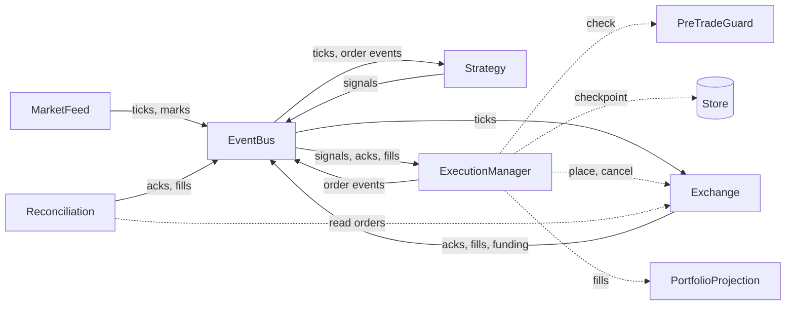
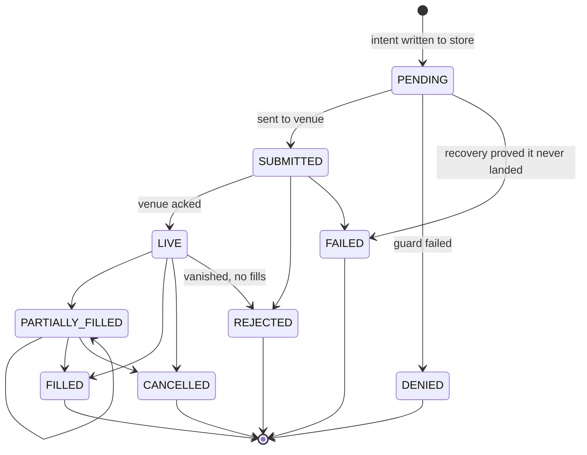
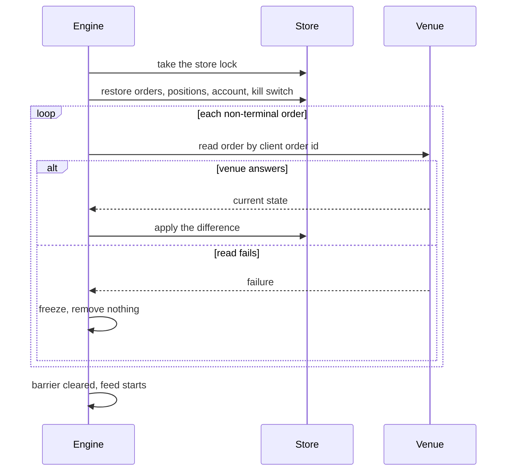
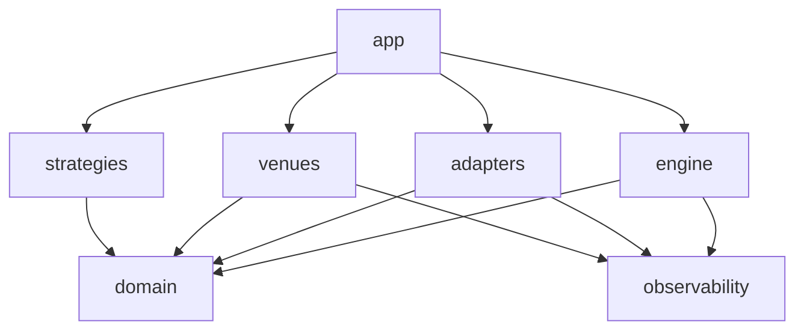

# Tickwright

A readable, event-driven algorithmic trading engine.

[](https://github.com/MarcosACH/tickwright/actions/workflows/ci.yml)
[](LICENSE)

You bring a config and a strategy. Tickwright handles the rest: the market feed, the event flow,
order execution, crash recovery, and reconciliation against the exchange. It runs one venue per
process, on paper or on real money.

The engine is a small, typed Python core. It is built to be read, tested, and extended.

## Quickstart

You need Python 3.13 and [uv](https://github.com/astral-sh/uv). The default setup runs a paper
exchange on a recorded tick file. It needs no external service and no API key.

```bash
uv venv && uv sync      # create the venv and install locked dependencies
uv run pytest           # run the hermetic test suite
cp .env.example .env    # the sample config
uv run tickwright       # run the engine
```

The run replays [`examples/ticks.jsonl`](examples/ticks.jsonl) through the demo
`SingleShotMarketStrategy` into the paper exchange. The order lifecycle shows up on stdout as
structured JSON:

```json
{"event": "engine.barrier_cleared", "run_id": "run-…", "level": "info"}
{"event": "engine.feed_started", "run_id": "run-…", "level": "info"}
{"event": "order.placed", "signal_id": "demo:BTC:1", "level": "info"}
{"event": "order.submitted", "signal_id": "demo:BTC:1", "level": "info"}
{"event": "order.filled", "cloid": "0x…", "level": "info"}
```

The engine keeps running after the file drains. Press Ctrl-C to stop it. It shuts down cleanly,
leaves resting orders alone, and exits `0`.

### Other setups

Every setting is an environment variable with the `TICKWRIGHT_` prefix. Edit `.env`, no code
changes. [`.env.example`](.env.example) lists every variable, its default, and the decision
behind it.

| Setup | Add to `.env` | Needs |
| --- | --- | --- |
| Live Hyperliquid market data, paper exchange | `TICKWRIGHT_FEED=hyperliquid`<br>`TICKWRIGHT_HYPERLIQUID__SYMBOLS=["BTC"]` | Nothing. The data channels are public. |
| Hyperliquid testnet, real order flow | The two lines above, plus<br>`TICKWRIGHT_EXCHANGE=hyperliquid`<br>`TICKWRIGHT_HYPERLIQUID__TESTNET=true`<br>`TICKWRIGHT_HYPERLIQUID__SIGNING_KEY=0x…` | A funded testnet wallet. |
| Kafka bus | `TICKWRIGHT_BUS=kafka` | `docker compose up -d kafka` |
| Postgres store | `TICKWRIGHT_STORE=postgres` | `docker compose up -d postgres` |

Set `TICKWRIGHT_HYPERLIQUID__TESTNET=false` and the same key to trade real money. Read the
[risk note](#risk) first.

## Run in a container

Each merge to `main` publishes `ghcr.io/marcosach/tickwright:sha-<commit>`. Each release publishes
`vX.Y.Z`. There is no `latest` tag, so you always choose the code you run. Every image is built for
`amd64` and `arm64`.

[`compose.example.yaml`](compose.example.yaml) runs a paper replay with a strategy from your own
directory. From the repo root:

```bash
IMAGE_TAG=sha-<commit> docker compose -f compose.example.yaml up
```

- **Your strategy.** Mount your strategy directory at `/strategies`. The image puts it on the
  import path. Config names the class as `module:Class`. For
  [`examples/strategies/buy_once.py`](examples/strategies/buy_once.py) that is `buy_once:BuyOnce`.
- **Config and keys.** Plain config goes in an env file, like
  [`examples/paper.env`](examples/paper.env). Keys go in `.env.secrets`, which git ignores. No key
  is in the image.
- **The store.** It lives in the `/data` volume. Keep that volume. Without it a restart cannot
  recover the saga.

### Restarts

The compose restarts the engine on failure at most 3 times. Docker counts those restarts over the
container's whole life. A long healthy run does not reset the count. So a fault after weeks of
running still uses one of the 3. After the third fault the engine stays down. Run
`docker compose up -d` to start it again. That resets the count to 0. Alert on a stopped container.

Docker restarts on any exit code that is not `0`. It cannot skip exit `2`. So a boot refusal also
starts 3 more times, refuses each time, and then stays down.

### A strategy that needs its own libraries

The image has Tickwright and its dependencies only. If your strategy needs another library, build
a small image on top of a published one:

```dockerfile
FROM ghcr.io/marcosach/tickwright:vX.Y.Z
COPY --from=ghcr.io/astral-sh/uv:0.11 /uv /bin/uv
USER root
RUN uv pip freeze --python /app/.venv/bin/python > /tmp/installed.txt \
    && grep -v '^tickwright' /tmp/installed.txt > /tmp/engine.txt \
    && uv pip install --python /app/.venv/bin/python -c /tmp/engine.txt numpy
USER tickwright
```

The `-c` constraint keeps every engine dependency at the version the image shipped with. If your
library needs another version of one, the build fails. Without it, the install could change an
engine dependency and nothing would warn you.

Then set `image:` in your compose file to the tag of the image you built.

## How a tick becomes an order

Solid arrows are events on the `EventBus`. Dashed arrows are direct method calls.



- The `EventBus` is the only coupling between components. Everything publishes and subscribes by
  event type. Reads are never bus messages. Reconciliation reads the venue by a direct call.
- The `PreTradeGuard` runs before every placement. It checks size and price validity, min notional,
  and the kill switch. A failed check denies the order and nothing is sent.
- Pre-trade limits are optional caps the guard also checks, such as a max order size per symbol.
  They are off by default. Set the ones you need (see `.env.example` and ADR-0051).
- The `ExecutionManager` writes every order state to the `Store` before it touches the network.
- `Reconciliation` compares local order state with the venue on a schedule and heals the
  difference. A failed venue read is never treated as an empty venue. On a failed read it freezes
  and removes nothing.
- The `PortfolioProjection` keeps one `Position` per symbol and one `Account` per process. Every
  fill updates the position, the account cash line, and the order checkpoint in one transaction.

The runtime is a single `asyncio` process. All time flows through an injected `Clock`, so tests
never sleep.

## Order lifecycle

Every order is a small state machine keyed by its client order id. Each transition is checkpointed.



`SUBMITTED` can also go straight to `PARTIALLY_FILLED`, `FILLED`, or `CANCELLED` when the venue
reports the fill with the ack. A timeout never moves an order. Only reconciliation moves a stuck
`SUBMITTED`.

## Crash recovery

The `PENDING` record is written before the network send. So a crash at any point leaves a record
the engine can check against the venue on restart.



Restarting converges to the same state. No double fill and no orphaned order. The kill switch is
durable too. A halt outlives a crash and is cleared only by an explicit reset.

## Operate it

| Signal | Effect |
| --- | --- |
| `SIGINT` / `SIGTERM` | Graceful stop. Exit code `0`. |
| `SIGUSR1` | Trip the kill switch. New orders are denied. Resting orders stay. |
| `SIGUSR2` | Reset the kill switch. |

Exit `1` means the engine faulted. That is the restart signal for your supervisor. Exit `2` means
the engine refused to start: a config that does not validate, a strategy entry it cannot load, a
store bound to another account, or an account mode the venue reported and the engine refuses. A
restart would refuse again, so do not restart on `2`. Fix the cause first. Docker cannot skip
exit `2`. See [Restarts](#restarts).

One engine owns a store at a time. A second engine on the same store exits `1` and names the
process that holds it. The lock ends when that process stops or dies, so a crash never leaves it
stuck.

### Cancel every resting order

Stop the engine, then run `uv run tickwright cancel-all`. It reads the same config as a normal
run. It cancels every order resting in the account, including orders placed by hand, and exits. It
works on paper and on Hyperliquid. On Hyperliquid it cancels perp orders on the first perp dex
only. It leaves spot orders and orders on other perp dexes resting. Each spot order it leaves is
logged as `exchange.spot_order_skipped`.

| Exit code | Meaning |
| --- | --- |
| `0` | Done. A final venue read found no resting order. |
| `1` | Stopped partway, by a signal, a fault, or orders that survived two cancels. |
| `2` | Never started. Another engine holds the store, no engine has used the store, the store cannot be opened, or the config is not usable. |

The kill switch stays as it was. The last log line is `exit.finished`, which says what is left.

A store no engine has used is almost always the wrong directory. The engine you meant to stop may
still be trading somewhere else. So the run exits `2` with `exit.refused` and `reason=new_store`,
and touches nothing. If the store really is new, pass `--new-store`. The run then logs
`exit.new_store` with a warning and goes on. `flatten` makes the same check and takes the same
flag.

### Close every position

Stop the engine, then run `uv run tickwright flatten`. It trips the kill switch first, so the
engine does not trade when it restarts. Then it cancels every resting order and closes every
position with a reduce-only market order. It uses the same exit codes as `cancel-all`.

On paper with the replay feed, each close fills at the last row of the replay file. On a live
feed, it also subscribes to every coin the account holds, including coins not in your config. Each
close goes out once its coin has a trade and a mark. Hyperliquid with the replay feed exits `2`
before it touches anything, because a real close must be priced from the live market.

A position the feed never priced is not closed. The run exits `1`, and `exit.finished` names the
symbol and its size, for example `left=BTC=0.02`. Under `GUARD=noop` there is no kill switch to
trip, so the run warns with `exit.unguarded`.

## What it does today

- Venues: [Hyperliquid](https://hyperliquid.gitbook.io/hyperliquid-docs) (mainnet and testnet),
  and a deterministic in-process paper exchange with a configurable fill model.
- Feeds: live Hyperliquid WebSocket, and a JSONL replay feed for deterministic runs.
- Buses: `InMemoryBus` and `KafkaBus`.
- Stores: `SQLiteStore` and `PostgresStore`.
- Accounting: positions, realized and unrealized PnL, fees, funding, margin, liquidation price,
  equity, and free margin. Perps only. On live, the numbers are checked against the venue's
  account snapshot and a disagreement is alerted.
- Strategies: two reference strategies that place one market or one limit order. They exist to
  exercise the pipeline. Your own strategy stays in your repo, and config names it by import path.
- Operator commands: `tickwright cancel-all` on paper and Hyperliquid, and `tickwright flatten` on
  paper replay.
- Packaging: a container image on GHCR for `amd64` and `arm64`, with an example compose.

Each seam has exactly two implementations. One would look hardcoded. Three would be scope creep.

## What it is not

- Not a backtester. The replay feed is a test feed, with no performance analytics.
- Not a risk engine. The accounting surface reports. It never rejects an order on margin and it
  never liquidates.
- Not a plugin system. You extend it by implementing a Protocol. See
  [`docs/extending.md`](docs/extending.md).
- Not fast. It is Python, and it competes on clarity, not latency.
- No GUI, no notifications, no strategy library.

## Package layout

```
src/tickwright/
  domain/         # events, seam Protocols, value types, the order state machine
  engine/         # ExecutionManager, Reconciliation, Cache, PreTradeGuard, runner
  adapters/       # bus/, store/, feed/, paper/, clock/
  venues/         # hyperliquid/
  strategies/     # reference strategies
  observability/  # named events, correlation ids, structured logging
  app/            # composition root: build_engine(config) and the CLI
```

Dependencies point one way. `import-linter` enforces the direction in CI.



## Learn more

- [`CONTEXT.md`](CONTEXT.md): the domain glossary. Start here.
- [`docs/module-maps/v1-core-engine.md`](docs/module-maps/v1-core-engine.md): each module, its
  interface, and why it exists.
- [`docs/extending.md`](docs/extending.md): how to add a strategy, a venue, or a backend.
- [`docs/adr/`](docs/adr/): one record per design decision, with the alternatives rejected.
- [`CONTRIBUTING.md`](CONTRIBUTING.md): setup, checks, test tiers, and how we work.

## Risk

Tickwright is at version `0.x`. It is not certified for real money. Run it against real funds at
your own risk. It is not financial advice.

## License

[Apache-2.0](LICENSE).
